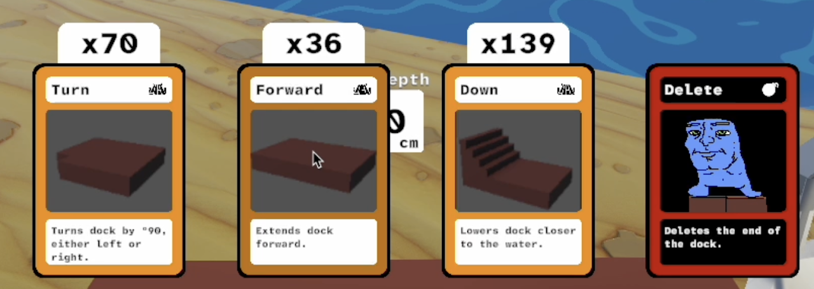
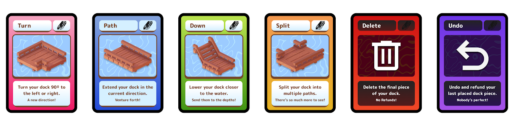

As the lake is drained, the player needs a way to continue sipping fish, and so I created our dock building system.

# Dock Building Design Process

Sip Fisher's dock building mechanic wasn't part our original idea of the game, but it came up in early design brainstorming.

An early prototype of the water sipping mechanic revealed an issue: the water level of the lake constantly going down meant the player had to constantly move down, creating an inch-by-inch forward motion that was extremely awkward.

We were also looking for a way to provide some amount of creative expression, since that was something we believed was an important aspect of our inspiration game, A Game About Digging A Hole. Creative expression would also mean every playthrough was somewhat guaranteed to be unique, which is great for content creators.

From these requirements, we came up with the idea of grid-based dock building. It provides a well bounded amount of creative expression, and it turns the constant inching forward into a well paced incremental building mini-game.

## Getting started

Being tasked with designing and implementing this mechanic, I started by just making the basic dock pieces - a forward, turn, and down piece - which could be arranged end to end to build any kind of path.

I knew the size of the dock would be really important since the player would be walking around on them in first person for most of the game, but without any game context yet, I had to pick an arbitrary size just to get things moving.

## First pass at dock building

Once I had the pieces, I set up a simple interaction where the player could click a toolbox to enter a building mode and choose to build one of three pieces.

Early on, I thought treating the dock pieces as cards could be a really good interface analogue, since the player would be buying many dock pieces simultaneously and then being presented to choose to "play" them one at a time. This gave me a lot of useful card game concepts to pull from, both mechanically and in the UI.

In this video, you can see my fist iteration of the dock placing menu. The general structure actually persisted to the final product, namely the card selection, close (cancel) button, and the ghost preview of the selected dock piece.

This iteration already worked pretty well for building the dock , although the rotate and confirm sub menu after clicking a card was a bit awkward since the UI is hidden until you enter that state. There was also an issue that you had to click the toolbox to place a new piece, which meant looking away from where you were trying to place a toolbox.

These are all issues I would work on fixing in later iterations.

## Moving the player

In this iteration, I added functionality for automatically moving the player to the ideal position to view their newly placed dock pieces.

This helped a lot with the readability of the mechanic, and had the nice side effect of making the game feel a bit more efficient since the the dock building interaction can pull you forward from a distance as you walk up to it.

This really highlighted another issue though - when the player is trying to build multiple dock pieces in sequence, it quickly becomes tedious to click the toolbox, place a piece, and then click the toolbox again. Ideally, the player would stay in the dock building menu until they explicitly decided to leave.

## Improving piece confirmation

As I mentioned earlier, the confirmation/rotation sub menu was quite awkward. This video shows a fun side effect of the positioning of the confirmation button. It's an accident I would have been inclined to leave in the game, however the position of the button meant it was only possible for cards that happened to align with the sub menu button, so I wanted to find something better.

What I went with was turning the card itself into the confirmation button. When a card is selected by the player, it rises up to indicate selection, and then can be clicked a again to confirm. This gives the fun speed-bridging behavior from rapidly clicking, while making it work for every card. Turning the card into the confirm button also worked beautifully to signify when the card can be selected but not placed due to blocking level geometry (shown in the video as the red X over the card and the piece highlight turning red).

Moving the card up also gave me the idea of hiding the deselect button under each card, something which intuitively ties the action to that card. This also gave me the idea to tuck the rotate button underneath the cards as well. This makes it intuitively only show for the card for which its relevant (the turn piece, and later intersection piece). 

### Delete/Undo Actions
You can also see I had added delete and undo cards in these iterations. These were crucial actions for making the dock building more forgiving to mistakes and for allowing more player expression. Showing them as other cards allowed me to get more use out of the card confirm/cancel concept that I was already building for players (although that was not implemented at this stage).

### Card Design
These iterations also show the first view of the dock piece cards, which I'll go into more detail later.

## Branching dock paths

Something that became more and more important as we began to understand the level design of the game was that we wanted to allow the player to build branching dock pathways. This would allow us to have little ponds emerge as you drain the lake that the player could branch over to as a form of exploration beyond just going down the lake.

This mechanic required a lot of refactoring, especially with my save system, since the dock was no longer a single list of pieces. Thankfully,  the UX design I had already done for the dock building system mostly held up to this new requirement.

One thing that did end up changing was the earlier choice to keep the player in the dock building menu as they place pieces. For branching paths and in order to keep the player in the dock building menu, the game would need to pick left or right arbitrarily, which may or may not be the direction the player wants to keep building. Therefore, I decided in this instance to kick the player out of the dock building menu so that they could intentionally decide what to do next, whether that is continue building left or right, or stop building entirely.

## Dock piece cards

An important piece of the dock building system was the dock piece cards. Making the dock pieces into cards has a lot of benefits when building the UI, but it also has an undeniable appeal, one which I wanted to lean into as much as possible.

You can see in my first iteration of the cards that I prioritized showing the piece that would be placed and the name of the piece to clarify its purpose (since the early dock meshes were somewhat indistinct).

When I was doing a polishing pass on the cards, I went for a cutesy lighthearted aesthetic, along with a brightened orthographic screenshot of our polished dock piece meshes. I also gave each dock piece a unique color to help differentiate them.

At this point we had also determined that the card flavor text wasn't super critical to gameplay, so I gave each card a fun little message to add some extra joy.

I also continued my initial design of making the action cards (delete/undo) explicitly different, inverting the white elements of the regular cards to black and giving them large icons.

I designed all versions of the cards using Figma and by gathering screenshots of our 3D models in Unity.

## Final state of dock building

Here you can see the state of dock building in the final game. I'm really proud of where the mechanic ended up and the response I got from players.

It's also a really great showcase of the cohesion between our disciplines, bringing together my programming and design with the excellent sound design and 3D art of my teammates.

Small UX improvements I made throughout the project.

- Grid  
    I added a simple grid visual on the water while in the dock building mode to show valid dock placements, as well as provide a frame of reference for players as they plan out their dock expansion. The grid fades out over distance for a smoother visual appeal.
    
- Darkening Cards  
    When a card is selected, all other cards darken to make it more clear which card is being focused on.
    
- Delete Card Movement  
    The delete/undo button slides down to reveal a confirmation button, while normal cards slide up to reveal an optional cancel button. I did this to help prevent accidentally double clicking the delete/undo button since its a destructive action. This usually catches players off guard the first time before they quickly understand how it works. I like having that small amount of friction around an action with potentially negative consequences.
    
- Hiding Information  
    The delete button only becomes visible if the player has already used their one undo action, helping to declutter the interface of the delete button in circumstances where they wouldn't really want to use it.
    
- Close Button Position  
    I moved the "Close" button of the dock building menu around the screen a few times in different iterations (bottom left, bottom center, etc) but in the end I decided to go with bottom right. This is because when the player approaches the toolbox on the dock to enter the menu, they are usually facing straight down the dock, and so they have to turn left to face the toolbox. This physically moves their mouse left on their mouse pad in real life, and so I wanted to make closing the menu cancel-out that real-world movement by having the button on the right side of screen. This is an issue I noticed while testing the game myself, that I would click on the toolbox, then click to leave the menu, and doing that repeatedly my mouse would get incrementally pushed to one side of my mouse pad.
    
- Camera Panning  
    Even with the player being automatically moved into a good spot to see where they were building their dock, there were still edge cases where it was hard to see what you were building. I addressed this by giving the player a small amount of camera control while in the dock building menu, letting the position of their mouse on screen tilt the camera. This also gives the menu a bit more motion and thus appeal in my opinion. Since all most of Sip Fisher's menus are in world space or relevant in world space, I brought this effect to other menus like the fish sipping mode and shop.